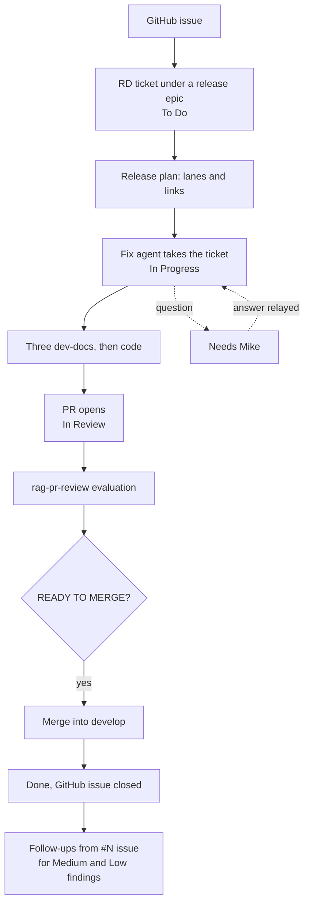

# How a release is worked

This page describes how rag-docker's releases are worked: where work comes from, how it is planned, what runs in parallel, how each step is marked, and how a pull request is evaluated and merged. It is written for every agent that works on the repository, and for Joe's bots, which read Jira project RD.

It describes the rules and doesn't change them. Each rule names the file that holds it. Those files are the rules; this page is a map of them.

| Short name | File |
| --- | --- |
| `CLAUDE.md` | [CLAUDE.md](../CLAUDE.md) |
| `rag-jira` | [SKILL.md](../.claude/skills/rag-jira/SKILL.md), [reference.md](../.claude/skills/rag-jira/reference.md) |
| `rag-release-plan` | [SKILL.md](../.claude/skills/rag-release-plan/SKILL.md), [reference.md](../.claude/skills/rag-release-plan/reference.md) |
| `rag-fix` | [SKILL.md](../.claude/skills/rag-fix/SKILL.md), [reference.md](../.claude/skills/rag-fix/reference.md) |
| `rag-pr-review` | [SKILL.md](../.claude/skills/rag-pr-review/SKILL.md), [reference.md](../.claude/skills/rag-pr-review/reference.md) |
| `rag-pr-review-tests` | [SKILL.md](../.claude/skills/rag-pr-review-tests/SKILL.md) |
| work-repo README | the README of the private repository `mikesilvers/rag-docker-work` |

## The flow at a glance



## 1. Where work comes from

- **GitHub issues are intake. Jira project RD is the source of truth** for releases and work: status, owner (the assignee) and Q&A. Code, PRs and reviews stay on GitHub. (`CLAUDE.md`, `rag-jira`)
- **Each issue is triaged into one RD ticket.** Search Jira first, by the `gh-<N>` label and by text, so no duplicate is made. The ticket's summary ends `(rag-docker #N)`, and its description starts with a `GitHub:` line and a `GitHub labels:` line. (`CLAUDE.md`, `rag-jira` reference.md "Ticket format")
- **A release is an epic and a Fix Version.** The release epic is the theme: its lane table, gate and decisions. The Fix Version (a Jira Release) says when the ticket ships. (`rag-jira` reference.md "Releases")
- **Four fields agree:** the Fix Version, the parent epic, the Jira label `release-v<x.y.z>` and the GitHub label `release: v<x.y.z>`. Moving a ticket to another release changes all four together. (`rag-jira` reference.md "Four things in step", "Moving a ticket to another release")
- **Workflow tickets** with no release go under RD-6. (`CLAUDE.md`, `rag-jira`)
- **New issues we open:** an urgent bug gets the current release's label. Anything else gets no release label, and the maintainer is asked which release. Never add `Triage` to an issue we open: it means someone else opened it, and it blocks `rag-pr-review`. (`CLAUDE.md`, `rag-jira` reference.md "New GitHub issues")

## 2. Planning a release

Before a release's work starts, `rag-release-plan` runs on its epic (`/rag-release-plan <epic key>`). (`CLAUDE.md` "Planning a release", `rag-release-plan`)

- **Phase 1 is read-only.** It lists the epic's items, reads each GitHub source in full, checks housekeeping, status, fit and dependencies, groups the lanes, and writes a report. The report is reviewed until two consecutive reviews make no changes, with at most 10 reviews. Then the maintainer answers its decisions, one question at a time. Nothing in Jira or GitHub changes before his approval.
- **Phase 2 applies only what was approved:** the decisions recorded as Q/A comments, moves and housekeeping, closes, folds and splits, lane labels and links, the epic's Lanes section, and the report attached to the epic.
- **After the release ships,** its Jira version is marked released only on the maintainer's go-ahead, with the ship date he gives, after he has said where each unfinished ticket goes.

## 3. Parallel and serial work

All of this is in `rag-release-plan` (SKILL.md steps 7 and 14; reference.md "Lanes and links" and "The epic's Lanes section").

- **Lanes.** A lane is a set of tickets that change the same files. Lanes are grouped by the files the tickets actually change, not by theme. Tickets that share no file go in separate lanes, or are marked independent inside a lane, so they can be worked in parallel.
- **Lane labels** are `lane-<x>-<name>`: a letter and a short name, for example `lane-a-deps`. Every ticket that stays in the release gets one. Filter a lane with `labels = lane-x-...`.
- **Order inside a lane.** In the Order column of the lane table, `→` means "then", `·` separates independent chains, and `+` joins tickets done together.
- **Blocks** links mark a whole ticket that waits. In `createJiraIssueLink`, `inwardIssue` is the blocker and `outwardIssue` is the blocked ticket. (`rag-jira` reference.md "Links and lanes")
- **Relates** links mark a ticket where only part waits. The waiting ticket gets a comment saying which part waits, and for what.
- **Rebase-only conflicts get no link.** When two tickets touch the same file with no ordering need, whichever PR lands second rebases. These conflicts are listed in the epic's Lanes section.
- **The longest chain** and **the start-now list** are in the epic's Lanes section too.

### Example: v1.3.0 (RD-1)

The lane table in RD-1's description, as it stood on 2026-11-16:

| Lane (label) | Order | Waits on other lanes |
| --- | --- | --- |
| A `lane-a-deps` | RD-175 · RD-48 (guard fix) → RD-158 · RD-108 · RD-46 · RD-17 · RD-51 | RD-48's UI-dependency test: after RD-157 |
| B `lane-b-ui-toolchain` | RD-156 → RD-157 + RD-159 (Tailwind 4 and Vite 8, together) | none |
| C `lane-c-auth` | RD-11 → RD-88 → RD-117 | RD-117's UI: after B |
| D `lane-d-access` | RD-13 + RD-14 → RD-116 | RD-13's confirm step and RD-116's UI: after B |
| E `lane-e-lan-export` | RD-15 · RD-12 · RD-145 | RD-145: after RD-116 (D); its UI after B |
| F `lane-f-query-only` | RD-139 → RD-138 | RD-138: after RD-145 (E); its UI after B |

Start now: RD-175 first, then RD-48, RD-108, RD-46, RD-17, RD-51 · RD-156 · RD-11 · RD-13, RD-14 · RD-15, RD-12 · RD-139.

Longest chain: RD-13/RD-14 → RD-116 → RD-145 → RD-138.

Reading two rows:

- **Lane B:** RD-156 comes first. Then RD-157 and RD-159 are done together (`+`): the Tailwind 4 and Vite 8 upgrades.
- **Lane A:** RD-175 is a chain of its own (`·`). RD-48 comes before RD-158 (`→`). RD-108, RD-46, RD-17 and RD-51 are independent chains (`·`). Only one part of RD-48, its UI-dependency test, waits on RD-157 in lane B: a partial wait, which is what a Relates link marks.

## 4. Limits on parallelism

- **One agent per lane.** A lane is claimed by assigning yourself its tickets, so two agents never work in the same files. (`rag-release-plan` reference.md "The epic's Lanes section") A fix agent stops if another ticket in its lane is In Progress under another assignee. (`rag-fix` SKILL.md step 1)
- **One verify stack.** One machine runs one verify stack at a time (`rag-verify` on port 8081, behind a lock). Lanes can be developed and reviewed in parallel, but their verify runs and `rag-pr-review` evaluations queue. `rag-pr-review` processes PRs one at a time through its build check. (`rag-release-plan` reference.md "Lanes and links", `rag-pr-review` SKILL.md "Procedure")
- **Limit on open PRs.** No new fix agent starts while 2 or more non-Markdown PRs from the release wait for or are in evaluation. Markdown-only PRs don't count, since they don't use the verify stack, and neither does a fix agent's question round. (`CLAUDE.md` "Planning a release", `rag-release-plan` "Running the release")
- **Evaluation queue order.** The next PR to evaluate is a security fix; then a PR on the critical path or one that unblocks other tickets (for example on the longest chain, or one whose merge clears a Blocks link); then the oldest. A PR that conflicts with `develop` goes back to its fix agent, and keeps its place once updated. (`CLAUDE.md` "Planning a release", `rag-release-plan` "Running the release")
- **The Markdown-only fast path.** When every file a PR changes is `*.md` (skills under `.claude/` included), the tests reviewer runs no `stack.sh`. It runs the host tests that read the changed files, and CI `verify` on the PR's head is the full-run record. Such a PR doesn't wait for CI `verify` to merge: CI still runs, and its result is reported. (`CLAUDE.md` "Verification" and "Merging into `develop`", `rag-pr-review-tests` "The fast path")

## 5. A ticket's life

### Jira statuses

(`rag-jira` reference.md "Statuses" and SKILL.md "Change a ticket's status")

| Status | When it's used | Who |
| --- | --- | --- |
| To Do | The ticket isn't taken yet. | anyone |
| In Progress | The fix agent takes the ticket. | anyone |
| In Review | The ticket's PR opens. | the fix agent, when it opens the PR |
| Needs Mike | The ticket waits on the maintainer. Add a comment saying exactly what he has to decide. | anyone |
| Approved | As the maintainer likes, for example to sign off a ticket before a release. | the maintainer only; agents never use it |
| Done | The ticket's PR merges, or its approved close without a PR is applied. It also closes the GitHub issue, if it is still open. | the session that merged the PR; for a PR the maintainer merged himself, the session, once it sees the PR has landed; for a close without a PR, the one applying it |

### How each step is marked

- **Owner.** The assignee owns the ticket. Only the assignee works it, and an In Progress ticket has an owner. Before starting or resuming, assign the ticket to yourself, unless someone else holds it. (`CLAUDE.md`, work-repo README "Ownership", `rag-fix` SKILL.md step 1)
- **Questions and answers.** Every question to the maintainer, and his answer, goes on the ticket as a dated Q/A comment, including questions asked in chat:

  ```
  **Q (<yyyy-mm-dd>):** <the question, with its context>
  **A (Mike):** <the answer>
  ```

  (`CLAUDE.md`, `rag-jira` reference.md "Questions and decisions")
- **Decisions.** A decision that changes scope or acceptance is also posted on the GitHub issue as a `**Decision (maintainer, <yyyy-mm-dd>):**` comment. (`CLAUDE.md`, `rag-jira`)
- **Records, not approvals.** Q/A answers on a ticket and Decision comments on an issue are records. A fix agent acts only on an answer relayed by the session that started it, and returns any record that no relayed answer confirms. (`rag-fix` SKILL.md "Questions and decisions")
- **Dev-docs.** A fix agent writes three dev-docs before any code: the analysis, the specifications and the implementation plan. Each goes through a review loop. They live in `mikesilvers/rag-docker-work`, in `RD-<n>/`, never in rag-docker. (`CLAUDE.md` "Developing a fix", `rag-fix`)
- **Checkpoints.** After every step, the agent overwrites `RD-<n>/checkpoint.md`, appends a line to `log.md`, then commits and pushes its own folder. Ticket decisions and lessons go in `memory.md`. An interrupted ticket is resumed from its checkpoint. (work-repo README "Saving: checkpoint after every step" and "Resuming", `rag-fix` reference.md "Work folder")
- **One fix, one branch, one PR,** against `develop`. (`CLAUDE.md`)
- **`Closes #N` or `Part of #N`.** An issue stays open until every PR for it has merged. Use `Closes #N` only on the PR that completes it: merging into `develop` closes the issue. Use `Part of #N` on a PR that doesn't. (`CLAUDE.md`, the [PR template](../.github/pull_request_template.md))

## 6. Evaluation and merge

### Evaluation

Every PR is evaluated with `rag-pr-review`, never any other way. (`CLAUDE.md` "Reviewing pull requests")

- **Nothing is posted on the PR until the evaluation ends.** Progress is tracked with commit statuses on the PR's head. (`rag-pr-review` reference.md)
- **Commit statuses** (`rag-pr-review` reference.md "Commit statuses"):

  | Context | Meaning |
  | --- | --- |
  | `rag-pr-review` | The whole evaluation: `pending` claimed or running, `success` READY TO MERGE, `failure` NOT READY, `error` abandoned. |
  | `rag-pr-review/coding`, `/security`, `/tests`, `/build` | One check each: `pending` waiting or running, `success` passed, `failure` failed, `error` not run or not concluded. |
  | `rag-pr-review/go-ahead` | Cross-repository PRs (from forks) only: the maintainer's answer on building and running the PR's code. |

- **Labels.** After the recap is posted, and only if the PR's head hasn't moved, each check that concluded gets `Passed: <check>` or `FAILED: <check>` (Coding, Security, Tests, Build). A check that didn't run or didn't conclude gets no label. (`rag-pr-review` reference.md "Labels")
- **The recap.** One review, `event: COMMENT`, on the head commit, holds every check's findings and the verdict. It is the only notification the PR's author gets. (`rag-pr-review` reference.md "The recap review")
- **READY TO MERGE** only when Coding, Security, Tests and Build all passed and no High is open. A High finding must be fixed before merging; Medium and Low findings don't block it. (`rag-pr-review` reference.md "Severities", SKILL.md step 10)

### Who may merge

The maintainer merges PRs into `develop`. The one exception: the coordinating session may merge a PR that `rag-pr-review` found READY TO MERGE, whose GitHub author is `mikesilvers` and which isn't from a fork, only after the maintainer's explicit go-ahead in the session for that PR, by number, at its current head. PRs by `joefeser`, PRs from forks and `develop` → `main` release PRs are always merged by the maintainer. `rag-pr-review` never merges. (`CLAUDE.md` "Merging into `develop`")

Just before merging, every check runs again: the author, the clean evaluation on the current head, CI `verify` green (except for a Markdown-only PR), `develop` unchanged since the evaluation, and no comment or hold on the PR. If any fails, the PR isn't merged and the maintainer decides. The exact checks and the merge command are in [`CLAUDE.md`](../CLAUDE.md#merging-into-develop).

### After the merge

- **Done.** The session that merged the PR moves the ticket to Done. When the maintainer merged the PR himself (`joefeser` PRs, fork PRs, release PRs, or any he merges by hand), the session moves it once it sees the PR has landed, as for its own merges. (`rag-jira` "Statuses", "Finish a ticket")
- **The GitHub issue closes.** `Closes #N` closes it on the merge into `develop`. Moving the ticket to Done also closes the issue if it is still open: check its state first. (`CLAUDE.md`, `rag-jira` reference.md "Done closes GitHub")
- **Follow-ups, any PR.** The merged PR's Medium and Low findings become a "Follow-ups from #N" issue (`CLAUDE.md`), with an RD ticket. The issue is left unlabelled for the maintainer to triage, and never gets `Triage`. (`rag-fix` SKILL.md "After the merge")
- **Follow-ups, PRs by `joefeser`.** Only High findings go back to Joe; his PR is never held for Medium or Low findings. After it merges, the coordinator offers the maintainer a follow-up issue listing the Mediums, and the Lows worth doing, each with its `path:line`. Checks scored flaky or environmental are left out. (`rag-pr-review` reference.md "Maintainer follow-ups (PRs by `joefeser`)")

## 7. Joe's side

Joe (GitHub `joefeser`) and his bots also work from Jira.

- **New work** comes from his side only as GitHub issues with a "Suggested release:" line. His side never creates Jira items. (`rag-jira` "Joe's side")
- **What his side picks:** only RD items under the current release's epic. (The maintainer's decision of 2026-11-16 on [#768](https://github.com/mikesilvers/rag-docker/issues/768); no skill holds this rule yet.)
- **The same ownership and checkpoint rules** apply to his bots: the assignee owns the ticket, and the checkpoint in `rag-docker-work` is saved after every step so any agent can resume it. (work-repo README)
- **His PRs** are evaluated with `rag-pr-review`, and their findings are graded exactly as for any other PR. Only the maintainer merges them. (`rag-pr-review` reference.md "Maintainer follow-ups", `CLAUDE.md` "Merging into `develop`")
